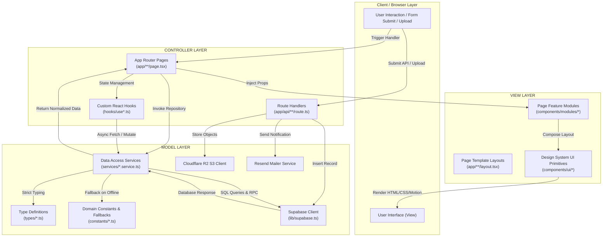

<div align="center">

# HMPSTI STMIK Widya Utama
### Official Web Portal & Student Innovation Hub

Pusat warta informasi, showcase karya teknologi mahasiswa, direktori kepengurusan & alumni, galeri kegiatan, serta direct portal akademik resmi Himpunan Mahasiswa Program Studi Teknik Informatika (HMPSTI) STMIK Widya Utama Purwokerto.

[](https://nextjs.org/)
[](https://react.dev/)
[](https://www.typescriptlang.org/)
[](https://tailwindcss.com/)
[](https://supabase.com/)
[](https://www.cloudflare.com/products/r2/)
[](https://resend.com/)
[](https://www.framer.com/motion/)

</div>

---

## 🌟 Fitur Utama

- **Direct Portal Academic Drawer**: Akses cepat satu klik menuju portal resmi kampus (SIAKAD, E-Learning LMS, Perpustakaan Digital, dan Website Utama Kampus).
- **Sticky Academic Radar Player Bar**: Dock pemutar bergaya Spotify di bagian bawah layar yang menampilkan berita terhangat (*Hotnews*), jadwal kegiatan hari ini (*Today Schedule*), dan agenda mendatang (*Upcoming Events*) secara tersinkronisasi.
- **Showcase Karya Mahasiswa & Formulir Pengajuan**:
  - Etalase portofolio produk software, IoT, game, dan riset AI buatan mahasiswa STMIK Widya Utama dengan filter kategori dan direct links.
  - Halaman pengajuan mandiri (`/karya/submit`) dengan **upload cover foto langsung ke Cloudflare R2 Object Storage** serta pengiriman email notifikasi instan ke pengurus via **Resend API**.
- **Galeri Foto Kegiatan Interaktif**: Lightbox responsif dengan penampung multi-foto (hingga 4 foto per kegiatan) dengan slide navigasi dan thumbnail preview, serta tautan langsung ke album lengkap Google Drive kegiatan.
- **Pusat Warta & Agenda Kegiatan**: Manajemen artikel rilis, liputan kegiatan, dan dokumentasi agenda organisasi dengan dynamic Open Graph cards untuk media sosial.
- **Bagan Struktur Organisasi & 6 Profil Divisi**: Informasi pimpinan BPH serta 6 divisi fungsional: PSDM, LPT, MEDKOMINFO, HUMAS, dan KWU lengkap dengan modal profil pengurus dan program kerja divisi.
- **Direktori Keanggotaan & Alumni**: Basis data profil mahasiswa aktif dan jejaring alumni Teknik Informatika dengan pencarian multi-parameter dan filter angkatan.
- **Kotak Aspirasi Mahasiswa**: Formulir penyampaian kritik, ide, dan saran daring dengan dukungan opsi identitas anonim, rate-limiting IP 10 menit, serta loading overlay.
- **Backoffice Admin Console (`/manage`)**: Panel kontrol operasional CRUD universal untuk 11 modul website yang dilengkapi manajemen multi-admin (`superadmin` & `admin`), proteksi rute sesi, dan antarmuka cyber dark-mode.
- **Ergonomic Loading Screen System**: Animasi logo resmi HMPSTI dikelilingi dual-orbiting green glowing rings pada transisi halaman (Next.js App Router Suspense), client router change, upload media ke Cloudflare R2, dan submit form.
- **Halaman Not Found 404 Kustom**: Tampilan ramah pengguna dengan branding resmi HMPSTI untuk menangani rute yang tidak ditemukan. Rute lama `/admin` dan `/login` telah dialihkan/diarahkan ke 404 untuk memperkuat keamanan URL `/manage`.
- **Atomic Optimistic Likes Engine**: Mesin reaksi apresiasi (like) yang concurrency-safe via Stored Procedure Supabase (RPC), instan tanpa jeda visual (*zero-lag UI*), dan tersinkronisasi ke PostgreSQL.

---

## 🏗️ Arsitektur MVC di Next.js (App Router)

Aplikasi mengadopsi standar **Model-View-Controller (MVC)** yang disesuaikan untuk ekosistem Next.js App Router modern:



### Pembagian Tanggung Jawab Lapisan

| Layer | Folder Proyek | Peran & Tanggung Jawab |
|---|---|---|
| **Model** | `types/`<br>`services/`<br>`constants/`<br>`lib/`<br>`app/api/` | Mendefinisikan struktur data domain, mengeksekusi operasi database (SELECT, INSERT, UPDATE, DELETE), mengelola integrasi Cloudflare R2 & Resend, dan menyediakan fallback data offline. **Bebas dari kode JSX/render visual.** |
| **Controller** | `app/**/page.tsx`<br>`hooks/` | Mengatur navigasi rute, mengelola siklus state React (loading, error, pagination), memproses validasi form, dan memanggil fungsi service. |
| **View** | `components/ui/`<br>`components/layout/`<br>`components/modules/`<br>`app/**/layout.tsx` | Murni menangani tampilan antarmuka (JSX, Tailwind CSS, animasi Framer Motion). Menerima data melalui props tanpa melakukan kueri database langsung. |

---

## 📁 Struktur Folder Proyek

```
hmps-ti/
├── app/                                 # Controller Rute, Halaman & Server Layouts
│   ├── layout.tsx                       # Root layout (Fonts, Providers, AppShell, SEO)
│   ├── loading.tsx                      # Global App Router Loading Screen (HMPSTI Orbit Spinner)
│   ├── not-found.tsx                    # Halaman 404 Kustom dengan Logo Resmi HMPSTI
│   ├── page.tsx                         # Beranda (Hero, Divisi, Bento, Showcase, Galeri)
│   ├── berita/                          # Portal warta & agenda kegiatan (+ [slug])
│   ├── divisi/[slug]/                   # Profil 6 divisi kepengurusan HMPSTI & Proker
│   ├── galeri/                          # Dokumentasi galeri visual kegiatan (Multi-photo slider)
│   ├── karya/                           # Portofolio karya teknologi mahasiswa (+ [slug])
│   │   └── submit/                      # Formulir pengajuan karya mahasiswa (+ R2 Upload)
│   ├── keanggotaan/                     # Direktori mahasiswa aktif & jejaring alumni
│   ├── kontak/                          # Formulir aspirasi mahasiswa & kontak sekretariat
│   ├── manage/                          # Backoffice Admin Console (11 Tab Manajemen)
│   │   ├── page.tsx                     # Dashboard utama backoffice
│   │   └── login/                       # Pintu masuk autentikasi backoffice admin
│   ├── struktur/                        # Bagan struktur organisasi pengurus & BPH
│   ├── visi-misi/                       # Visi, butir misi, dan indikator organisasi
│   ├── api/                             # Server Route Handlers
│   │   ├── aspirasi/route.ts            # Handler simpan aspirasi mahasiswa + rate limit IP
│   │   ├── submit-karya/route.ts        # Handler pengajuan karya + pengiriman email via Resend
│   │   └── upload-image/route.ts        # Handler upload cover karya ke Cloudflare R2
│   ├── robots.ts                        # Generator /robots.txt otomatis
│   └── sitemap.ts                       # Generator /sitemap.xml dinamis
│
├── components/                          # View Layer (Komponen Antarmuka)
│   ├── ui/                              # UI Primitives atomik
│   │   ├── LoadingSpinner.tsx           # Animasi logo HMPSTI + dual rotating glowing rings
│   │   ├── PageTransitionLoader.tsx     # Overlay transisi rute client-side
│   │   ├── Lightbox.tsx                 # Lightbox galeri multi-foto slider + internal scroll
│   │   ├── Button.tsx                   # Neubrutalist & Spotify variant buttons
│   │   ├── GlassCard.tsx                # Container kartu beraksen kaca & glowing
│   │   ├── CyberSelect.tsx              # Dropdown select interaktif bergaya cyber
│   │   ├── CyberDateTimePicker.tsx      # Kalender & pemilih waktu
│   │   ├── Badge.tsx                    # Tag status & kategori
│   │   └── Skeleton.tsx                 # Placeholder skeleton loading
│   ├── layout/                          # Kerangka struktural
│   │   ├── AppShell.tsx                 # Wrapper utama (Lenis, Drawer, BottomPlayer, Loader)
│   │   ├── Navbar.tsx                   # Top navigation bar responsif
│   │   ├── Footer.tsx                   # Footer informasi & tautan cepat
│   │   ├── BottomPlayerBar.tsx          # Dock pemutar Spotify akademik
│   │   ├── DirectLinkDrawer.tsx         # Drawer direct portal kampus
│   │   └── NavigationProgressBar.tsx    # Bar laser progres atas saat scroll
│   └── modules/                         # Subkomponen terisolasi per modul halaman
│       ├── admin/                       # Header, Navigation, Modals, dan 11 Tab Komponen
│       │   └── tabs/                    # AdminUsers, Aspirasi, Berita, Divisi, Galeri,
│       │                                # Karya, Keanggotaan, Proker, Settings, Struktur, VisiMisi
│       ├── berita/                      # NewsHero, NewsGrid, EventCard, SearchFilter
│       ├── home/                        # HeroSection, BentoHighlights, Preview Divisi & Karya
│       ├── karya/                       # ProjectHero, ProjectGrid, FilterBar, DetailView
│       ├── galeri/                      # GalleryHero, GalleryGrid, Lightbox
│       ├── struktur/                    # OrgHeroLeadership, OrgBphSection, DivisionTabs
│       ├── keanggotaan/                 # MemberHero, MemberTable, MemberPagination
│       ├── visi-misi/                   # VisionHero, VisionSection, MissionList
│       └── kontak/                      # ContactHero, AspirationForm, ContactInfoCards
│
├── services/                            # Model Layer: Data Access Layer (Pure Async Repositories)
│   ├── adminUsers.service.ts            # Autentikasi & CRUD user admin pengurus
│   ├── aspirasi.service.ts              # CRUD & status baca aspirasi mahasiswa
│   ├── divisionPhotos.service.ts        # Pengaturan foto bersama per divisi & kabinet
│   ├── gallery.service.ts               # CRUD foto galeri dokumentasi & multi-photos
│   ├── likes.service.ts                 # Atomic RPC & optimistic local likes counter
│   ├── members.service.ts               # CRUD anggota & pengurus divisi
│   ├── news.service.ts                  # CRUD artikel berita & event kegiatan
│   ├── projects.service.ts              # CRUD showcase karya mahasiswa
│   ├── settings.service.ts              # Pengaturan konfigurasi identitas website
│   ├── visionMission.service.ts         # Pengaturan teks visi, butir misi & indikator
│   ├── workProgram.service.ts           # CRUD program kerja divisi organisasi
│   └── index.ts                         # Central barrel export seluruh service
│
├── types/                               # Model Layer: Definisi Tipe Data Terpusat
│   ├── aspirasi.ts                      # Interface Aspirasi, SubmitAspirasiPayload
│   ├── common.ts                        # NeubrutalistVariant & generic types
│   ├── gallery.ts                       # Interface GalleryItem, GalleryCategory
│   ├── members.ts                       # Interface DivisionMember, MemberDirectory
│   ├── news.ts                          # Interface NewsArticle, NewsCategory
│   ├── projects.ts                      # Interface StudentProject, ProjectCategory
│   ├── settings.ts                      # Interface SiteSettings
│   ├── visionMission.ts                 # Interface VisionMissionData, MissionPoint
│   ├── workProgram.ts                   # Interface WorkProgram, WorkProgramStatus
│   └── index.ts                         # Central barrel export seluruh interface
│
├── constants/                           # Model Layer: Konfigurasi Statis & Mock Fallback
│   ├── fallbackData.ts                  # Mock data lengkap saat mode offline
│   ├── categories.ts                    # Daftar kategori resmi konten
│   ├── navigation.ts                    # Tautan menu navigasi
│   └── index.ts                         # Central barrel export konstanta
│
├── hooks/                               # Controller Layer: Custom React Hooks
│   ├── useAdminSession.ts               # Cek status autentikasi sessionStorage & redirect guard
│   ├── useAsyncData.ts                  # Generic hook fetching data (loading, error, retry)
│   ├── useLikes.ts                      # Manajemen state toggle like interaktif
│   ├── useSearchFilter.ts               # Logika filter query pencarian & filter kategori
│   └── index.ts                         # Central barrel export hooks
│
├── lib/                                 # Utilitas & Klien Eksternal
│   ├── supabase.ts                      # Inisialisasi Supabase client & timeout helper
│   └── utils/                           # Helper cn, formatting tanggal, dan slug generator
│
└── supabase/                            # Skema Basis Data
    └── schema.sql                       # Master DDL Script, RLS Policies, RPC, & Initial Seeds
```

---

## 🗄️ Skema Basis Data (11 Tabel Supabase)

Database PostgreSQL dikelola via Supabase mencakup 11 tabel domain utama:

```mermaid
erDiagram
    SITE_SETTINGS {
        string id PK
        string current_period
        string email
        string whatsapp
        text address
        text map_embed_url
        timestamp updated_at
    }

    VISION_MISSIONS {
        string id PK
        text vision
        jsonb missions
        timestamp updated_at
    }

    DIVISION_PHOTOS {
        string division_slug PK
        string division_name
        string photo_url
        timestamp created_at
        timestamp updated_at
    }

    NEWS {
        uuid id PK
        string title
        string slug UK
        string category
        boolean is_event
        string author_name
        timestamp event_date
        string reading_time
        int likes_count
        text excerpt
        text content
        string cover_image
        boolean featured
        timestamp created_at
    }

    STUDENT_PROJECTS {
        uuid id PK
        string title
        string slug UK
        string category
        text description
        text content
        string[] tech_stack
        string author_name
        string author_role
        string author_nim
        string author_email
        string author_avatar
        string cover_image
        string demo_url
        string github_url
        string orbit_url
        int likes_count
        timestamp created_at
    }

    DIVISION_MEMBERS {
        uuid id PK
        string name
        string nim
        string role
        string division_slug
        string avatar
        string email
        string instagram_url
        string github_url
        string linkedin_url
        string[] social_links
        int likes_count
        boolean is_bph
        int sort_order
        timestamp created_at
    }

    MEMBERS {
        uuid id PK
        string name
        string nim UK
        string cohort
        string status
        string role
        string avatar
        string variant
        string email
        string instagram_url
        string github_url
        string linkedin_url
        string[] social_links
        int likes_count
        timestamp created_at
    }

    GALLERY_ITEMS {
        uuid id PK
        string title
        string category
        string event_date
        string url
        string[] photos
        string drive_url
        text description
        int likes_count
        timestamp created_at
    }

    WORK_PROGRAMS {
        uuid id PK
        string division_slug
        string title
        string status
        string execution_date
        text description
        string pic
        string target_audience
        string budget
        timestamp created_at
        timestamp updated_at
    }

    FEEDBACK {
        uuid id PK
        string sender_name
        string sender_email
        string email
        string subject
        text message
        boolean is_read
        boolean is_anonymous
        timestamp created_at
    }

    ADMIN_USERS {
        uuid id PK
        string username UK
        string password_hash
        string keterangan
        string role
        boolean is_active
        timestamp created_at
        timestamp updated_at
    }
```



---

## 🚀 Panduan Instalasi & Pengembangan

### Prasyarat Sistem
- **Node.js**: Versi 18.18.0 atau yang lebih baru (disarankan Node.js v20 / v22 LTS)
- **Package Manager**: `npm`, `pnpm`, atau `yarn`

### Langkah Instalasi

1. **Clone Repositori**:
   ```bash
   git clone https://github.com/hmpsti-swu/hmpsti-swu-website.git
   cd hmpsti-swu-website
   ```

2. **Install Seluruh Dependensi**:
   ```bash
   npm install
   ```

3. **Konfigurasi Environment Variables**:
   Salin file template `.env.local.example` menjadi `.env.local`:
   ```bash
   cp .env.local.example .env.local
   ```
   Buka file `.env.local` dan isi kredensial layanan Anda (lihat rincian tabel variabel di bawah).

4. **Eksekusi Skema Database Supabase**:
   Buka [Supabase Dashboard](https://supabase.com/dashboard) -> Masuk ke proyek Anda -> **SQL Editor** -> Buka file `supabase/schema.sql`, salin seluruh kodenya dan klik **Run**.
   Script ini secara otomatis akan:
   - Membuat seluruh 11 tabel lengkap dengan tipe datanya
   - Mengonfigurasi Row Level Security (RLS)
   - Membuat Stored Procedure `increment_like_atomic`
   - Mengisi seed awal (visi-misi, identitas, foto divisi, akun admin default)
   - Membuat indeks performa kueri

5. **Jalankan Server Pengembangan**:
   ```bash
   npm run dev
   ```
   Buka peramban di [http://localhost:3000](http://localhost:3000).

6. **Kompilasi Versi Produksi**:
   ```bash
   npm run build
   npm run start
   ```

---

## 🔑 Variabel Lingkungan (Environment Variables)

| Variabel | Wajib / Opsional | Deskripsi |
|---|:---:|---|
| `NEXT_PUBLIC_SUPABASE_URL` | Opsional* | URL endpoint proyek Supabase (contoh: `https://xyz.supabase.co`). |
| `NEXT_PUBLIC_SUPABASE_ANON_KEY` | Opsional* | Kunci publik API (*anon key*) Supabase untuk kueri sisi klien. |
| `SUPABASE_SERVICE_ROLE_KEY` | Opsional | Kunci Service Role Supabase untuk operasi server-side route handler. |
| `RESEND_API_KEY` | Opsional | API Key Resend untuk mengirimkan notifikasi submission karya ke email pengurus. |
| `R2_ACCESS_KEY_ID` | Opsional | Access Key ID S3 Client Cloudflare R2 untuk upload gambar karya. |
| `R2_SECRET_ACCESS_KEY` | Opsional | Secret Access Key S3 Client Cloudflare R2. |
| `R2_ENDPOINT` | Opsional | Endpoint S3 Cloudflare R2 (contoh: `https://<account_id>.r2.cloudflarestorage.com`). |
| `R2_BUCKET_NAME` | Opsional | Nama bucket Cloudflare R2 (default: `hmpsti`). |
| `R2_PUBLIC_URL` | Opsional | Public URL dev atau custom domain R2 (contoh: `https://pub-xxx.r2.dev`). |
| `NEXT_PUBLIC_SITE_URL` | Opsional | Domain kanonikal website untuk resolusi sitemap dan Open Graph. Default: `https://hmpsti-swu.vercel.app`. |

> *\*) Catatan:* Jika kredensial Supabase tidak diisi, website otomatis beralih ke mode **Fallback Offline Data** tanpa mengalami crash atau error tampilan.

---

## 🛡️ Akses Backoffice Pengurus (`/manage`)

Akses panel kontrol manajemen website dilakukan melalui rute resmi:

- **Halaman Login**: `/manage/login`
- **Dashboard Operasional**: `/manage`
- **Akun Bawaan (Default Seed)**:
  - **Super Admin**: `superadmin` | Kata Sandi: `admin123`
  - **Admin Pengurus**: `admin_hmpsti` | Kata Sandi: `admin123`
- **Fitur Backoffice**:
  - Terdapat **11 Modul Tab**: Berita, Karya, Galeri, Keanggotaan, Struktur, Program Kerja, Kotak Aspirasi, Foto Divisi, Visi & Misi, Pengaturan Website, serta **Manajemen Akun Pengurus** (tambah, edit hak akses `superadmin`/`admin`, reset password, aktif/nonaktifkan user).
- **Proteksi Keamanan**:
  - Token sesi disimpan di `sessionStorage` browser pengurus.
  - Rute lama `/admin` dan `/login` telah dihapus dan dialihkan ke halaman **404 Not Found**.

---

<div align="center">

**Himpunan Mahasiswa Program Studi Teknik Informatika (HMPSTI)**  
STMIK Widya Utama Purwokerto • Jawa Tengah

</div>
